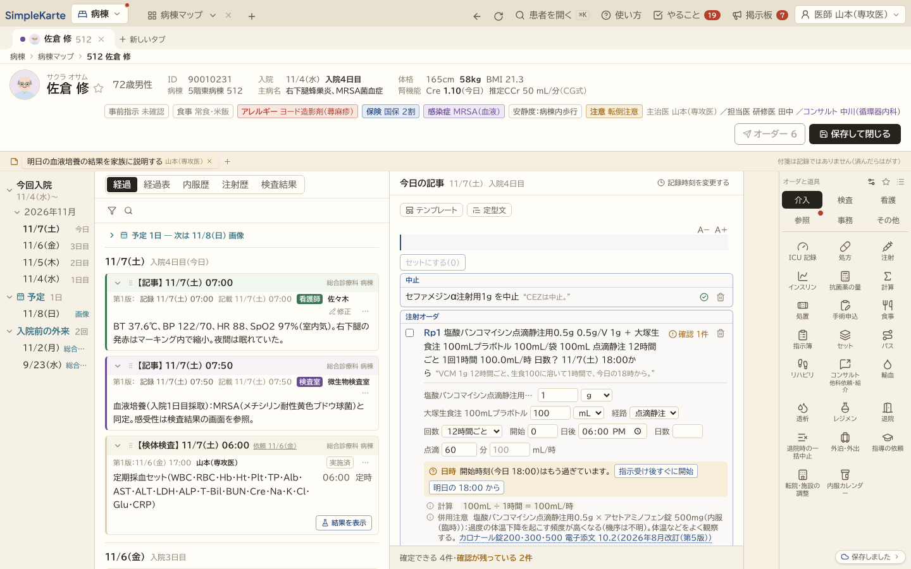

# Simple Karte


**病棟の医師が話した指示を、Claude がオーダーの下書きにする電子カルテです。** 計算と確認はコードが式と出典つきで行い、確定するのは医師です。
「Built with Claude: Japan 2026」の期間中（2026-11-02〜11-08）に、新しく作りました。

**触ってみる：https://simple-karte.vercel.app** （ログインは要りません。Chrome で開いてください）

> 表示される患者・病院・職員・検査値・院内の取り決めは、すべて架空のデータです。実際の診療には使えません。



## 何を解決するか

病棟では、回診のあとに医師が指示を電子カルテに入れます。口で言えば数秒の「VCM 1g 12時間ごと、生食100に溶いて1時間で、今日の18時から」が、画面では薬・量・溶かす輸液・経路・回数・点滴時間・開始時刻を1つずつ選ぶ作業になります。点滴の速さの計算、すでに出ている点滴との重複、血中濃度を測る時刻の逆算も、医師の頭の中で行われています。

Simple Karte では、医師が話す（打つ）と、Claude が言葉を項目に分けて院内のマスターの番号を当てます。量・速さ・時刻の計算と、重複・併用注意・配合の確認はコードが行い、あいまいなところは選択肢つきで聞き返します。医師が答えて確定します。

その下書きが入る先として、病棟の1日を回せる電子カルテを作りました。医師・看護師・薬剤師・臨床検査技師・診療放射線技師・療法士・管理栄養士・MSW（医療ソーシャルワーカー）・医事課・臨床工学技士・ICT（感染制御チーム）・歯科衛生士の12職種が、同じ記録を自分の画面で使います。ICU・HCU の重症の患者の記録も同じカルテにつながっています。

## 3分で試す（審査員の方へ）

1. 上の URL を開き、「病棟マップ」を押します。512号室の「佐倉 修」（MRSA 菌血症、入院4日目）を押すと、カルテが開きます。
2. まん中の「今日の記事」の1行目に、次の1行を貼り付けて Enter を押します。`/claude` に続けて書いた指示を、Claude が下書きにします。

   ```
   /claude CEZは中止。VCM 1g 12時間ごと、生食100に溶いて1時間で、今日の18時から。血培2セット今日もう一回。明日朝 CBC、生化、CRP。VCMの血中濃度は3回目の前に。ヴィーンFは1日2本を続けて、20時間で。
   ```

3. 数秒で、記事の下に6件の下書きが並びます。黄色の「確認」に答えてください。
   - 「20時間で」は1袋あたりか、1日分か → 両方の速さを計算した選択肢から選びます（「1袋を20時間で」は1日40時間になるので、コードが止めます）。
   - すでに有効なヴィーンFがある → 置き換えるか、追加するか。
   - 18時を過ぎていれば → 「指示受け後すぐに開始」か「明日の18:00から」。
   - VCM の血中濃度は、開始の時刻と12時間ごとから、3回目の投与の前の採血の時刻をコードが出します。
4. すべてそろうと、右上の「オーダー」が押せます。確定すると左の経過に入り、中止した CEZ と置き換えたヴィーンFに印が付きます。
5. 右上の「医師 山本（専攻医）」を押して「看護師」に替えると、ワークシートが開き、「指示の変更」にいま確定した指示が並びます（ヴィーンFは変更の前と後が並びます）。看護師が内容を確かめて「指示を受ける」を押します。

## ほかに見てほしいところ

- **ICU・HCU**：試験用の病棟 https://simple-karte.vercel.app/?scenarios=100 で「ICU・HCU」を開きます（人工呼吸・CRRT・昇圧薬などの12人）。ベッドの札にカーソルを置くと SOFA・出納・持続投与が出ます。カルテの右の道具「ICU 記録」で、24時間の時間表、SOFA の点の根拠、呼吸器の設定と実測、持続投与の γ と mL/h を見られます。
- **計算（Σ）**：右の道具「計算」。SOFA・NIHSS・自由水欠乏量・補正 Na・CCr・A-DROP など。カルテの値が入り、式を出し、「記事に入れる」で記事に貼ります。
- **`/by system`**：記事に `/by system` と書くと、器官系ごとのプロブレムリストの枠に、カルテのバイタル・検査・投与中の薬を貼ります。
- **職種を替える**：右上の名前から、12職種のどれにでも替えられます（デモなのでログインの代わり）。職種ごとに最初の画面と、確定できる操作が変わります。
- **試験用の病棟100人**：`?scenarios=100` を付けると、救急外来 → 入院 → 退院 → 外来の筋書きを持つ架空の患者100人と、ICU・HCU・救急外来の12人が入ります。
- **Claude Code から使う**：下の「Claude Code とつなぐ」。
- 画面にある機能の一覧は [docs/features.md](docs/features.md)、作りながら決めたことは [docs/decisions.md](docs/decisions.md) にあります。

## 決めるのは医師、AI は入力係

- **Claude がすること**：話し言葉を、薬・量・単位・回数・点滴時間・採血日時・処置の部位や大きさの言葉などの項目に分けて書き出すことだけ。院内のマスターにある番号を当てます。言われていない項目は空のまま返し、勝手に埋めません。
- **コードがすること**：単位の誤り、量と時間と速度の計算、大きさの言葉から面積と点数表の範囲の区分、1日の酸素量、1日に収まるか、有効なオーダとの重複、電子添文にある併用禁忌・併用注意・配合の組み合わせ（出典のリンクつき）、日時の解釈（「明日朝」→ 定時採血）、薬の濃度を測る時刻（「3回目の前」→ 開始時刻と間隔から計算）、項目の抜け。判定はすべて決まった規則で、計算式を画面に出します。
- **医師がすること**：聞き返しに答えて、確定すること。アプリは量や薬の選び方を勧めません。
- Claude に送るのは、話した文と院内のマスターだけです。**患者の情報は送りません。** お薬手帳・救急隊の連絡・透析条件・手術申込の読み取りも、送るのは打った（話した）文だけで、画面に「氏名は入れない」と書いています。


## Claude の使い方

### 作品の中

Claude（`claude-opus-5-5`）の役目は、どの場面でも「人が話した・打った文を、決まった形に写す」ことだけです。答えの形は zod のスキーマで固定し（structured outputs）、院内のマスターはシステムプロンプトに入れてキャッシュします。読み取りだけの仕事なので effort は low にし、待ち時間を短くするため fast mode を使い、使えないときは普通の速さで答え直します。

| 場面 | Claude がすること | コードがすること |
|---|---|---|
| オーダーの指示（記事の `/claude`、`/api/draft`） | 薬・量・回数・時刻などに分け、マスターの番号を当てる | 量・速さ・時刻の計算、重複・併用注意・配合、1日に収まるか、聞き返しの選択肢 |
| バイタルの口述（`/api/vitals`） | 「38度2分、脈104」を数値に写す | NEWS2 の計算と確認 |
| 申し送り I-PASS（`/api/handoff`） | 話した文を「患者の要約・やること・もし〜なら」に分ける | バイタル・指示・結果待ちをカルテから集める |
| 持参薬（`/api/mochikomi`） | お薬手帳の薬の行を表に写す | 院内の薬との照合 |
| 救急隊の連絡（`/api/hotline`） | 話した内容を項目に写す | 再評価の目安の時間。トリアージは看護師が入れる |
| 手術申込・透析条件・食事・退院サマリの経過（`/api/or-request`・`hd-order`・`diet`・`discharge`） | 項目・欄に写す（足したり言い換えたりしない） | 抜け・重なり・締切・上限の確認 |
| Claude Code から（MCP、`/api/mcp`） | 匿名化した患者を読み、下書きを作る | 仮 ID・年代・相対の日付への置き換え、下書きの検証。確定は医師がアプリで |

### 作る過程

この作品は Claude Code を中心に作りました（6日で約900コミット、テスト約5,100件）。

- **引き継ぎ**：決めたことと次にやることを CLAUDE.md と引き継ぎのメモに書き、セッションが変わっても続けました。設計の判断は [docs/decisions.md](docs/decisions.md) に残しています。
- **並列**：画面の作業は git worktree ごとに Claude のサブエージェントに出し、作業の前後のスクリーンショットを見比べてから取り込みました。難しい設計（ICU・HCU の記録を病棟のカルテとつなぐ）は Claude Fable 5.1 に相談して決めました。
- **点検をくり返す**：ヘッドレスのブラウザで「職種ごとに1日を回す」点検をして、落ちる・消える・数が合わない・二重を直し、また点数を付ける、をくり返しました（例：医師 65→82点、看護師 72→85点）。
- **確かめ**：本物の Claude Code から MCP で本番につなぎ、下書きの URL がカルテで開くところまで通しました。

## 作者の以前の自作との関係

作者（医師）は以前から、外来のカルテの試作（ファストカルテ。試作は [hoken-karte](https://github.com/yuya847/hoken-karte) として公開）と、抗菌薬の計算ツールを個人で作っています。

- 画面の構造（どこに何を置くか）は、ファストカルテの使い勝手を参考にしています。富士通の電子カルテ（HOPE/EGMAIN-GX）の製品カタログで公開されている考え方（常に見える患者基本情報バー、複数の患者のカルテを同時に開く、過去の記録を日付からたどる）も参考にしました。
- コード・画面の部品・CSS・データは、すべてハッカソンの期間中に新しく書いたものです。以前の自作からのコピーや流用はありません。色と書体も別のものにしています。
- 場面は外来ではなく病棟で、主役は話した指示の下書きです。

作った過程は、このリポジトリのコミットの履歴で確かめられます。


## データと出典

患者・病院・職員・検査値・院内の取り決めは、すべて架空です。点数表・通知・電子添文・ガイドライン・DICOM などの公的な出典と、どのファイルで使っているかは [docs/sources.md](docs/sources.md) にまとめています。

## 開発

```bash
npm install
cp .env.example .env.local   # ANTHROPIC_API_KEY を自分で入れる
npm run dev
npm test                     # 確認のルールのテスト
```

### 記録の保存（Supabase、任意）

`NEXT_PUBLIC_SUPABASE_URL` と `NEXT_PUBLIC_SUPABASE_PUBLISHABLE_KEY`（公開用のキー）を環境変数に入れると、その日の記録（架空の患者だけ）が Supabase に保存され、再読み込みしても残ります。入れなければ、これまでどおり保存しません。

1. Supabase のプロジェクトの SQL Editor で `supabase/schema.sql` を1回実行します（表 `workspaces` と、保存・読み込み・消去の3つの関数）。表そのものは公開用のキーから読めず、ブラウザは自分の記録の ID を知っている関数だけを呼べます。
2. 2つの値を Vercel の環境変数（と手元の `.env.local`）に入れます。キーはリポジトリに入れません。手元で `npm run dev` を動かしていれば、http://localhost:3210/setup のフォームに入れると `.env.local` と Vercel の本番の環境変数（手元の `vercel` コマンドで）に入ります（開発用のサーバーでだけ動きます）。
3. 画面の右下に「保存しました」と出ます。「ほかの端末で開くリンク」で同じ記録を別の端末で開け、「初めの状態に戻す」で今日の記録を消して初めからにします。

架空の患者のデータは「今日」を基準にした日付で作られているので、保存した記録はその日のうちだけ読み込み、日が変わると初めの状態から始まります。実在の患者の情報は入れないでください。

**同時利用（任意）**：`supabase/schema.sql` の後ろの「同時利用」の部分（表 `workspace_presence` と関数 `touch_presence`）も実行すると、同じ記録を開いている別の端末どうしが分かり（10秒ごと。架空の職員名と患者の番号だけ）、別の端末で保存されたことにも気づけます。表は公開用のキーから読めず、10分より古い行は呼ばれるたびに消えます。

**別の端末とのやりとり（Realtime）**：別の端末の保存・開いているカルテ・直している記事の文字は、Supabase Realtime の Broadcast で届きます。SQL は要りません。プロジェクトの Realtime の設定（Project Settings › Realtime）で「Enable Realtime service」と「Allow public access to channels」が入っていれば動きます（どちらも初めから入っています）。チャンネルはワークスペースの id ごと（`simple-karte:ws:<id>`）なので、id を知る人（記録のリンクを持つ人）だけが聞けます。流れるのは架空の職員名・患者の番号・打っている記事の文字だけで、記録そのものは RPC で保存します。Realtime が切れているときは、30秒ごとに保存先を読んで合わせます。

### ログインの仕組み（任意・既定はオフ）

「システム管理」の「ログインと自動ログアウト」で、この端末だけで入れられます（設定・パスワードのハッシュ・失敗の回数は、この端末のブラウザの localStorage にだけ残ります）。サーバーで本人を確かめるものではないので、実際の運用には使えません。サーバーの認証（たとえば Supabase Auth）につなぐときは、次が要ります（この試作ではつないでいません）。

1. Supabase の Authentication で利用者を作り（パスワードは本人が決める）、多要素認証（TOTP など）を必ず入れます（ガイドライン システム運用編 14 ⑤：令和9年度に向けて二要素認証）。
2. `workspaces` などの表と関数を、ログインした人（`authenticated`）だけが自分の病院の行を読み書きできるように行単位のセキュリティ（RLS）で書き直し、公開用のキー（`anon`）からの呼び出しを外します。
3. アプリのログインの画面を Supabase Auth のサインインに替え、職種は利用者の情報（病院が登録したもの）から決めます。自動ログアウトはいまの画面ロックのまま使えます。

## 技術

- [Next.js](https://nextjs.org) 16（App Router）、TypeScript、Tailwind CSS、lucide-react
- [Anthropic TypeScript SDK](https://github.com/anthropics/anthropic-sdk-typescript)、zod
- vitest（確認のルールのテスト）
- 公開先：Vercel

## Claude Code とつなぐ

```sh
claude mcp add --transport http simple-karte https://simple-karte.vercel.app/api/mcp
```

- `list_patients`：病名（diagnosis）・科（department）・入院中/外来（status）で絞って患者一覧。
- `get_patient(patient)`：仮IDから問題リスト・アレルギー・体重・腎機能・バイタル・検査・有効なオーダ・記事。
- `search_master(kind, query)`：drug / oral / injection / topical / lab / procedure の名前・コード検索。
- `propose_orders(patient, orders)`：AiWireOrder または AiOrder の配列を検証し、下書きを開くURLを返す。道具一覧に入力の JSON Schema があります。

例：Claude Code に「誤嚥性肺炎で入院中の患者を探して読み、医師の指示『セフトリアキソン 2g 1日1回 点滴 5日間、明朝 CBC と CRP』の下書きを作って」と頼むと、匿名の患者を読み、マスターのコードで下書きを作って URL を返します。開くとその患者のカルテの下書きの箱に並び、確定は医師がアプリで行います（Claude Code はオーダを確定できません）。

試験用の病棟（一般病棟100人と ICU・HCU・救急外来の12人。固定の種から作る架空の患者）の現在状態のみを扱い、Supabase や保存記録は読みません。患者IDは HMAC-SHA256 の先頭12桁による仮ID、年齢は10歳刻み、日付は入院日数・相対日付にします。名前・かな・生年月日・患者番号・住所・電話・保険番号・家族名・部屋番号は公開項目に含めません。記事等は既知の患者・家族・職員名、電話・日付・住所らしい表記を置換します（任意の自由文の完全な匿名化を保証する仕組みではありません）。`MCP_PSEUDONYM_SECRET` を設定すると仮IDの鍵を変更できます。未設定では固定の開発用文字列を使います。

**決めるのは医師、AI は入力係。** アプリはこの連携でAIを呼びません。返されたURLを医師が開くと、試験用病棟の患者の下書きに追加され、監査記録が残ります。オーダは確定されません。URLに下書き本文が含まれるため、試験データだけで使ってください。
